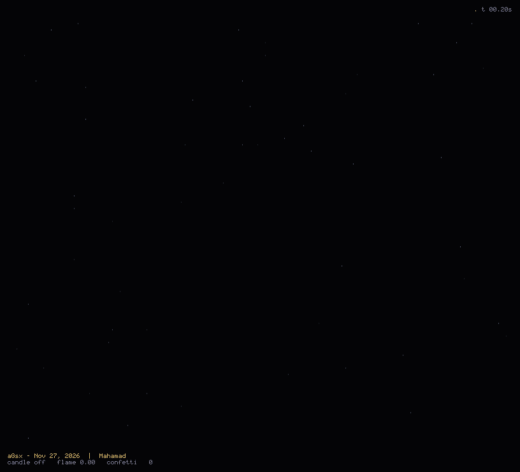
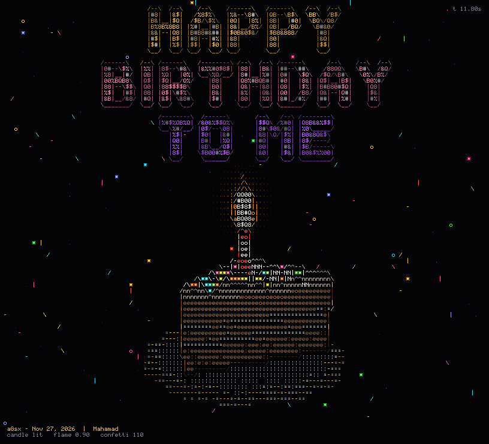

# Happy Birthday To Me (Nov 27) — Procedural ASCII Art (`aGsx`)



Pure-code procedural animated ASCII birthday celebration built with **Python**, **NumPy**, and **Tkinter** (`74×136` character grid rendered via a `6×10` NumPy glyph-atlas at `30 FPS`) — **zero video files, images, or external media behind the code**.

Created by **Mahamad (`aGsx` / `@aGsx-bit`)** for **Nov 27, 2026**.

## Preview (Final Scene)



## Features

- **100% Pure Procedural ASCII Shader:** Character-rain build sequence forming the layered birthday cake, animated flickering candle flame & spark glow, chamfered metallic/neon block typography (**`HAPPY BIRTHDAY TO ME`**), drifting colorful confetti, and live terminal HUD.
- **Smooth `30 FPS` Glyph-Atlas Engine:** Renders `10,064` colored ASCII cells (`816×740` px) directly to `tk.PhotoImage` using a `5×9` bitmap font across 70+ glyphs.
- **Interactive Controls:**
  - `R` — Restart animation from `t = 0.0`
  - `Space` — Pause / Resume without losing elapsed time
  - `A` — Jump directly to the final scene (`11.20s`)
  - `Esc` — Close window

## Quick Start

```bash
git clone https://github.com/aGsx-bit/happy-birthday-ascii.git
cd happy-birthday-ascii
pip install -r requirements.txt
python happy_birthday_to_me.py
```

## License & Mandatory Attribution

Licensed under the [Attribution Open Source License](./LICENSE).  
**Copyright © 2026 Mahamad (`aGsx` / `@aGsx-bit`).**

Anyone using, forking, recording, sharing, or building upon this project **must visibly credit Mahamad (`aGsx` / `@aGsx-bit`)** and preserve the original [LICENSE](./LICENSE) notice.

---
*Keywords: python ascii art, procedural ascii animation, birthday ascii art, tkinter ascii animation, numpy shader, creative coding python, generative art, terminal style animation, aGsx*
